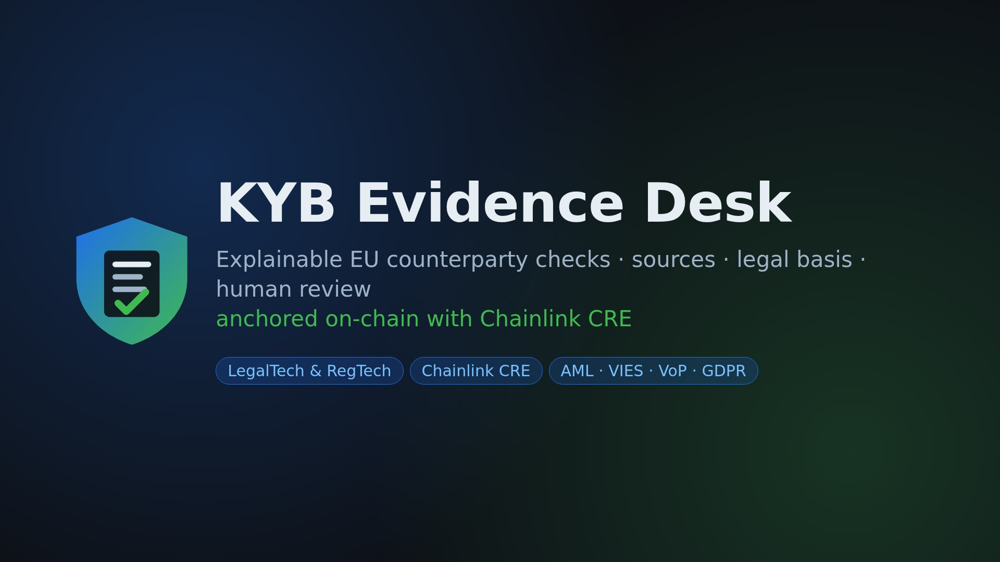
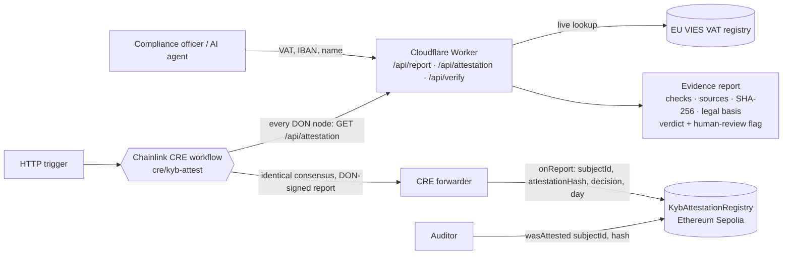

# KYB Evidence Desk

**Explainable, auditable EU counterparty due diligence for compliance teams and AI agents, with a Chainlink CRE workflow that anchors each verdict on-chain.**

[](https://nathanielc3d.github.io/kyb-evidence-desk/)

Live demo: https://kyb-evidence-desk.moneymachine.workers.dev  
Demo video (1:56, English captions, real screen recording of the live demo): https://nathanielc3d.github.io/kyb-evidence-desk/ (direct MP4: https://nathanielc3d.github.io/kyb-evidence-desk/video/kyb-evidence-desk-demo.mp4, also attached to the [v1.0.0 release](https://github.com/nathanielc3d/kyb-evidence-desk/releases/download/v1.0.0/kyb-evidence-desk-demo.mp4))  
Built for the [BLI Legal Tech Hackathon 2](https://dorahacks.io/hackathon/1904) (LegalTech & RegTech track, Chainlink "Best workflow with CRE" bounty).

## Problem

Before paying a supplier, onboarding a client or signing a contract, EU businesses must check who they deal with (AML customer due diligence, intra-EU VAT rules, Verification of Payee since October 2025). Today that check is a screenshot of a registry page, or a black-box "OK" from a vendor. When an auditor, a court or a regulator asks *"what exactly did you check, when, against which source, and why did you decide that?"*, nobody can answer with proof. AI agents that pay invoices make this worse: their decisions are fast and invisible.

## What it does

Give it an EU VAT number, optionally an IBAN and the name the counterparty claims. It returns an **evidence report**:

| Part | Content |
|---|---|
| Checks | Live EU VIES VAT lookup (registered name and address), IBAN structure (ISO 13616 mod 97 + registry length), IBAN country vs VAT country, claimed name vs registered name |
| Sources | For each check: source name, exact URL, retrieval time, SHA-256 of the raw registry response |
| Verdict | `pass` / `review` / `fail`, each reason with a stable code (`VAT_INVALID`, `IBAN_COUNTRY_MISMATCH`, `NAME_MISMATCH`...) and plain-English text |
| Legal basis | Each check mapped to its legal reference: AMLD art. 13 / AMLR, VAT Directive art. 138 + Reg. 904/2010 art. 31 (VIES), Instant Payments Reg. 2024/886 (Verification of Payee), GDPR art. 5(1)(c), 6, 22 |
| Human review | `human_review_required` flag + note: anything but `pass` must be escalated; even a pass needs a human sign-off for decisions with legal effect (GDPR art. 22) |
| Integrity | `report_sha256` over the canonical report, and an `attestation` hash over the stable facts. `POST /api/verify` recomputes both and detects any tampering |
| Privacy | The IBAN is masked in the report and only its SHA-256 enters the attestation. Nothing is stored. Only hashes go on-chain |

Fail-safe by design: when VIES is down or busy (frequent for France), the check is marked `unavailable` and the verdict is `review`, never a false `invalid`.

## Chainlink CRE bounty: requirement checklist

| Bounty requirement | Where it is met |
|---|---|
| Build a CRE workflow used as an orchestration layer in the project | `cre/kyb-attest/workflow.ts` (TypeScript SDK): it is the only path from a KYB check to the chain. HTTP trigger -> per-node fetch -> consensus -> signed report -> EVM write |
| Integrate at least one blockchain... | Ethereum Sepolia: `EVMClient.writeReport` to `contracts/KybAttestationRegistry.sol` (`IReceiver`, forwarder-only `onReport`) |
| ...with an external API / data source | EU VIES VAT registry (European Commission), reached through `GET /api/attestation` on the live Worker, plus IBAN and name rules |
| Demonstrate a simulation via the CRE CLI, or a live deployment | **`cre workflow simulate` passes end-to-end** with the official CLI v1.39.0: HTTP trigger -> live HTTP fetch of the Worker (HTTP 200) -> consensus -> signed report -> `EVM Chain WriteReport Dry-Run Successful` on Ethereum Sepolia. Output: [`docs/cre-simulate-output.txt`](docs/cre-simulate-output.txt), engine log: [`docs/cre-simulate-engine-log-excerpt.txt`](docs/cre-simulate-engine-log-excerpt.txt) |

### Simulation result (2026-10-24, CRE CLI v1.39.0)

Run with `./cre/simulate.sh` (logged-in CLI; `cre login` or `CRE_API_KEY`). The CLI prints box-local time (Paris) with a `Z` suffix.

```
$ cre workflow simulate kyb-attest --target staging-settings --non-interactive --trigger-index 0 \
    --http-payload kyb-attest/http_trigger_payload.ie.json
✓ Workflow compiled
  Binary hash: b415382311ff772118d02d30982b471e9a16b2b0e6be1ebc8f4589cc25223619
✓ Created HTTP trigger payload with 3 fields
[SIMULATION] Running trigger trigger=http-trigger@1.0.0-alpha
[USER LOG] KYB attestation requested for VAT IE6388047V
  (engine) HTTP Action Finished Status=200 URL=https://kyb-evidence-desk.moneymachine.workers.dev/api/attestation?...
[USER LOG] Consensus: decision=pass attestation=0x1bd938d11363f6d8857d8339a7cce6697ae5db8e2fc75325391af33d7af7b140 day=20261024
  (engine) EVM Chain WriteReport Started -> Dry-Run Enabled -> Dry-Run Successful
[USER LOG] Attestation written to 0x000000000000000000000000000000000000dEaD tx 0x0000…0000
✓ Workflow Simulation Result:
{"vat":"IE6388047V","decision":"pass","attestationHash":"0x1bd938d1…7b140","subjectId":"0xab8e1fd8…80b3c","day":20261024,"txHash":"0x0000…0000"}
Simulation complete!
```

The attestation hash is identical to the one the earlier 4-node live dry run produced, so the simulator, the SDK tests and the Worker agree byte-for-byte. The EVM write is a dry run (no `--broadcast`): the receiver is a placeholder and the tx hash is zero, because `KybAttestationRegistry` is not yet deployed on Sepolia.

Fix needed to get there: the CRE WASM runtime has no global `URL`/`URLSearchParams`, so zod's `.url()` failed config validation (`invalid_string, path: [apiBase]`). `apiBase` is now checked with a regex and the query string is form-encoded by hand (same output, covered by the tests).

## Chainlink CRE workflow (`cre/kyb-attest`)

**What the bounty asks, and where it is:** a CRE workflow that integrates a blockchain with an external API. Here: the external API is the EU VIES VAT registry (through our Worker, which adds IBAN and name rules and canonical hashing), and the blockchain is Ethereum Sepolia (`EVMClient.writeReport` to `KybAttestationRegistry`).

```
HTTP trigger {vat, iban?, name?}
  -> each DON node: GET /api/attestation (live VIES + IBAN + name rules)        [HTTPClient.sendRequest]
  -> consensus: every field must be identical across nodes                      [ConsensusAggregationByFields + identical]
  -> DON-signed report: abi.encode(bytes32 subjectId, bytes32 attestationHash,
                                   uint8 decision, uint32 yyyymmdd)              [runtime.report, ecdsa/keccak256]
  -> EVMClient.writeReport -> KybAttestationRegistry.onReport (Ethereum Sepolia) [only from the CRE forwarder]
```

| File | Role |
|---|---|
| `cre/kyb-attest/workflow.ts` | Handler `onKybRequest`: payload validation (zod), per-node fetch with strict parsing (`fetchAttestation`, fails closed), identical-fields consensus, ABI encoding, signed report, EVM write |
| `cre/kyb-attest/main.ts` | CRE `Runner` entry point (compiled to WASM) |
| `cre/kyb-attest/workflow.yaml`, `cre/project.yaml` | CRE CLI target `staging-settings` (Sepolia public RPC) |
| `cre/kyb-attest/workflow.test.ts` | 6 tests, including the full handler with the SDK's `HttpActionsMock` and `EvmMock` |
| `cre/kyb-attest/live-dryrun.spec.ts` | Opt-in (`LIVE=1`) dry run against the live API with N emulated nodes |
| `contracts/KybAttestationRegistry.sol` | `IReceiver` contract: forwarder-only `onReport`, per-subject history, `KybAttested` event, `wasAttested(subjectId, hash)` |

The attestation core deliberately excludes per-request timestamps (it keeps the UTC day), so independent nodes checking the same counterparty on the same day reach byte-identical bytes. If nodes see different registry answers (e.g. VIES busy for some of them), consensus fails and nothing is written: the workflow fails closed.

`contracts/KybAttestationRegistry.sol` accepts reports only from the CRE forwarder, keeps a per-subject history, emits `KybAttested`, and offers `wasAttested(subjectId, hash)` so an auditor can prove that a given report existed on a given day without the report being public.

### Recorded output (2026-10-24, CRE CLI v1.39.0)

Full logs: [`docs/cre-test-output.txt`](docs/cre-test-output.txt), [`docs/cre-live-dryrun-output.txt`](docs/cre-live-dryrun-output.txt), [`docs/cre-live-dryrun-failclosed.txt`](docs/cre-live-dryrun-failclosed.txt).

```
$ cd cre/kyb-attest && bun test
(pass) pure helpers > buildQueryUrl encodes all fields and trims the trailing slash
(pass) pure helpers > fetchAttestation parses a good response
(pass) pure helpers > fetchAttestation fails closed on HTTP errors and malformed bodies
(pass) pure helpers > encodeAttestation round-trips through the ABI the registry decodes
(pass) onKybRequest (full workflow with mocked capabilities) > fetches, reaches consensus, signs and writes the report
(pass) onKybRequest (full workflow with mocked capabilities) > rejects an empty or invalid trigger payload
 6 pass  1 skip (live dry run, opt-in)  0 fail

$ cd cre && cre workflow build kyb-attest --target staging-settings
✓ Workflow compiled successfully
  Binary hash: 7c4cbd57db974c7d2a9d69826cae04e5484c6d490edecbab4eede878845418df

$ LIVE=1 PAYLOAD=./http_trigger_payload.ie.json bun test live-dryrun.spec.ts
node 1: HTTP 200 decision=pass attestation=0x1bd938d11363f6d8857d8339a7cce6697ae5db8e2fc75325391af33d7af7b140
node 2: HTTP 200 decision=pass attestation=0x1bd938d11363f6d8857d8339a7cce6697ae5db8e2fc75325391af33d7af7b140
node 3: HTTP 200 decision=pass attestation=0x1bd938d11363f6d8857d8339a7cce6697ae5db8e2fc75325391af33d7af7b140
node 4: HTTP 200 decision=pass attestation=0x1bd938d11363f6d8857d8339a7cce6697ae5db8e2fc75325391af33d7af7b140
identical aggregation: all nodes agree byte-for-byte -> consensus reached
report payload abi.encode(subjectId, attestationHash, decision, day) = 0xab8e1fd8…3c 1bd938d1…40 …00 …013528a0
EVMClient.writeReport -> receiver 0x000000000000000000000000000000000000dead, gasLimit 300000
dry run OK (EVM write mocked: tx hash 0xabab… is a placeholder, no chain transaction)
```

Fail-closed case, captured live while VIES France was intermittently busy: node 1 got `pass`, nodes 2 to 4 got `review` (VIES unavailable), so the attestation hashes differ and `identical` consensus rejects the round. Nothing is written.

`cre workflow simulate` (the official local simulator) needs a free CRE account (`cre login` or `CRE_API_KEY`); it now passes, see "Simulation result" above. `cre workflow build` works without an account.

### How to run the simulation

```bash
# 1. Install the CRE CLI (https://github.com/smartcontractkit/cre-cli/releases) and Bun
cd cre/kyb-attest && bun install && cd ..
# 2. Compile only (no account needed)
cre workflow build kyb-attest --target staging-settings
# 3. Official simulation (free account): `cre login` or export CRE_API_KEY, then
./simulate.sh            # = cre workflow simulate kyb-attest --target staging-settings \
                         #     --non-interactive --trigger-index 0 --http-payload kyb-attest/http_trigger_payload.ie.json
# 4. Without an account: live dry run with the SDK test harness (4 emulated nodes, EVM mocked)
cd kyb-attest && LIVE=1 PAYLOAD=./http_trigger_payload.ie.json NODES=4 bun test live-dryrun.spec.ts
```

Tip: use the Irish payload (`http_trigger_payload.ie.json`) for a stable demo; VIES France often answers `MS_MAX_CONCURRENT_REQ`, which correctly yields `review` and can make nodes disagree.

To write for real: deploy `KybAttestationRegistry` on Sepolia with the forwarder address listed by `cre workflow supported-chains`, put its address in `cre/kyb-attest/config.staging.json`, and add `--broadcast` (needs Sepolia test ETH; not deployed yet. Zero-cost route: the pk910 PoW faucet needs no mainnet balance or account, but a human captcha plus in-browser mining to reach its 0.05 SepETH minimum, which covers the registry deploy and many writes).

## Architecture



Detailed view:

```
                       ┌──────────────────────────── Cloudflare Worker (src/worker.js) ───────────────────────────┐
browser / AI agent ──> │ /api/report  /api/attestation  /api/verify  /api/legal-basis   + HTML demo (src/page.js) │
                       │   ├─ src/evidence.js  checks, verdict rules, canonical JSON, SHA-256 hashes, verify      │
                       │   ├─ src/legal.js     legal reference per check (EUR-Lex links)                           │
                       │   ├─ src/iban.js      ISO 13616 mod 97 + registry lengths (offline)                      │
                       │   └─ fetch ──────────> EU VIES REST API (European Commission, live)                      │
                       └──────────────────────────────────────────────────────────────────────────────────────────┘
                                   ▲  GET /api/attestation (each node)
Chainlink CRE DON (cre/kyb-attest) ┘──> identical consensus ──> signed report ──> forwarder ──> KybAttestationRegistry (Sepolia)
                                                                                                └─ wasAttested(subjectId, hash) for auditors
```

Design choices:

- **Evidence over verdicts.** Every check carries its source URL, retrieval time and the SHA-256 of the raw registry response, so a reviewer can re-check it later.
- **Two hashes.** `report_sha256` covers the full canonical report (tamper evidence for the document); the attestation hash covers only stable facts (VAT, VAT validity, registered name, IBAN hash, claimed name, decision, reason codes, rules version, UTC day) so multiple DON nodes agree.
- **Data minimisation.** IBAN masked in the report; only `sha256(iban)` enters the attestation; only hashes go on-chain; nothing is stored server-side.
- **Fail-safe defaults.** Registry unavailable means `review`, never `invalid`; node disagreement means no write.
- **Human in the loop.** `human_review_required` plus a note citing GDPR art. 22 for decisions with legal effect.

API:

- `GET /api/report?vat=FR39356000000&iban=...&name=...` full evidence report
- `GET /api/attestation?vat=...` compact attestation used by the CRE workflow
- `POST /api/verify` (body = report JSON) recompute and compare hashes
- `GET /api/legal-basis` legal reference table

Examples from the live demo are in `examples/` (pass, review, fail, and a VIES-busy case).

## Test results (2026-10-24)

| Suite | Command | Result |
|---|---|---|
| Worker rules, hashing, verify, IBAN, legal map (VIES mocked) | `npm test` | 14 / 14 pass |
| CRE workflow: helpers + full handler with SDK `HttpActionsMock` / `EvmMock` | `cd cre/kyb-attest && bun test` | 6 pass, 1 skipped (opt-in live run) |
| Typecheck | `npx tsc --noEmit` | clean |
| CRE CLI compile to WASM | `cre workflow build kyb-attest --target staging-settings` | compiled, binary hash `7c4cbd57…418df` |
| Live dry run, 4 emulated DON nodes vs live API | `LIVE=1 bun test live-dryrun.spec.ts` | identical consensus, ABI report produced (EVM write mocked); fail-closed case captured |
| Official CRE simulator | `./cre/simulate.sh` | **passes end-to-end** (HTTP 200 -> consensus -> WriteReport dry run on Sepolia) |
| CI (GitHub Actions) | push to `main` | green |

## Run it

```bash
# Worker + rules (Node 20+)
npm test                     # 14 tests, offline (VIES mocked)
npx wrangler dev             # local demo on http://localhost:8787

# CRE workflow (Bun)
cd cre/kyb-attest && bun install
bun test                     # 6 tests: helpers + full workflow with mocked HTTP/EVM capabilities
npx tsc --noEmit             # typecheck
bun node_modules/@chainlink/cre-sdk/bin/cre-compile.ts main.ts /tmp/kyb-attest.wasm   # compiles to WASM

# CRE CLI: see "How to run the simulation" above
```

## Limits (honest)

- No beneficial-owner, sanctions or PEP screening yet: a `pass` means "registered and consistent", not "safe".
- Name matching is token overlap, not a bank Verification of Payee response.
- VIES does not publish names for some member states (e.g. DE); the name check is then skipped and said so.
- Not legal advice. Legal references are summaries for reviewers.

## Disclosure

Built by an AI agent (Grok Bot) operated by Nathaniel, as part of a public challenge. Code, tests, docs and the demo video (real headless screen recording of the live demo, synthetic Piper TTS narration) were produced by the agent; the operator reviews and submits.

## License

MIT
